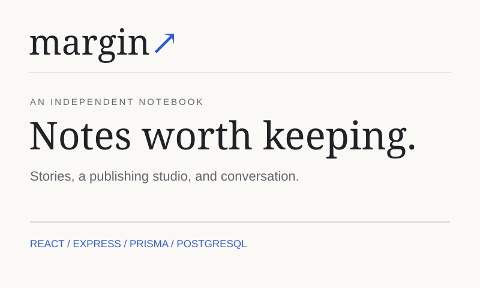
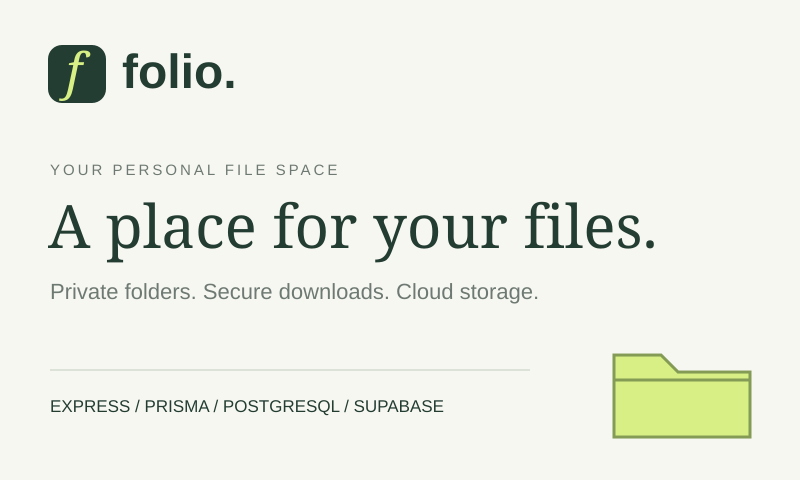

## Hi, I'm JC 👋

I'm an aspiring web developer from the Philippines, learning full stack JavaScript through [The Odin Project](https://www.theodinproject.com/). I build responsive React frontends and database-backed applications with Node.js, Express, Prisma, and PostgreSQL. My latest project, Midnight Market, is a deployed photo-tagging game with server-side guess validation, timed rounds, refresh recovery, and a persistent leaderboard. My work also includes Margin's separate reader and author apps, JWT authentication, PostgreSQL-backed sessions, and private file storage.

- 🎯 Goal: to work as a web developer on a team
- 🌱 Current focus: server-authoritative application state, REST APIs, authentication and authorization, database integrity, integration testing, and production deployment in The Odin Project’s Node.js course
- 🛠️ Workspace: VS Code, Git, GitHub, and Linux (WSL)

### Tech Stack & Tools

- **Frontend:** responsive HTML/CSS, JavaScript, React, React Router, and CSS Modules.
- **Back-end:** Node.js, Express REST APIs, routing and middleware, EJS views and partials, CRUD flows, pagination, server-side validation, and error handling.
- **Authentication & security:** JWT issuer/audience and expiry validation, Passport Local, bcrypt password hashing, PostgreSQL-backed sessions, ownership and role authorization, exact-origin CORS, CSRF protection for session-based apps, and rate limits.
- **Databases:** PostgreSQL, Prisma ORM and migrations, parameterized SQL with `pg`, connection pooling, relational models, and database constraints.
- **File storage:** private Supabase buckets, generated object keys, content-signature validation, owner-authorized downloads, quotas, and failure cleanup.
- **Deployment:** React apps on Vercel, static sites on GitHub Pages, and Express apps on Render connected to dedicated Neon PostgreSQL databases.
- **Testing:** Vitest, React Testing Library, user-event, Jest, and Node.js's test runner, including PostgreSQL integration tests.
- **Game state & persistence:** normalized image coordinates, server-side guess validation and timing, recoverable rounds, transactional updates, and persistent leaderboards.
- **Foundations:** API integration, state management, accessibility, data structures, and algorithms.

### Featured Projects

<table>
  <tr>
    <td width="50%" valign="top">
      
      <h4>Midnight Market · Photo Tagging</h4>
      
Find hidden characters in an original scene. Resume timed rounds and submit a score. Validate guesses and timing on the server. React · Express · Prisma · PostgreSQL

      <a href="https://midnight-market-eight.vercel.app/">Live demo</a> · <a href="https://github.com/jan-christopher-buen/odin-wheres-waldo">Code</a>
    </td>
    <td width="50%" valign="top">
      
      <h4>Margin · Blog API</h4>
      
Write stories in a private author studio. Publish drafts and moderate comments. Test JWT access and API permissions. React · Express · Prisma · PostgreSQL

      <a href="https://odin-blog-reader-pi.vercel.app/">Reader</a> · <a href="https://odin-blog-author-seven.vercel.app/">Author studio</a> · <a href="https://github.com/jan-christopher-buen/odin-blog-api">Code</a>
    </td>
  </tr>
  <tr>
    <td width="50%" valign="top">
      
      <h4>Folio · File Uploader</h4>
      
Store files in a private personal space. Organize folders and download files. Validate uploads and enforce quotas. Express · Prisma · PostgreSQL · Supabase Storage

      <a href="https://odin-file-uploader-k9d5.onrender.com/">Live demo</a> · <a href="https://github.com/jan-christopher-buen/odin-file-uploader">Code</a>
    </td>
    <td width="50%" valign="top">
      
      <h4>Common Goods · Shopping Cart</h4>
      
Browse a catalog of everyday goods. Edit quantities and manage your cart. Test routes and shopping interactions. React · Router · CSS Modules · Vitest

      <a href="https://odin-shopping-cart-lilac.vercel.app/">Live demo</a> · <a href="https://github.com/jan-christopher-buen/odin-shopping-cart">Code</a>
    </td>
  </tr>
</table>

<strong>More projects — 19 web projects</strong>

| Project | Focus | Links |
| --- | --- | --- |
| Members Only | PostgreSQL-backed sessions, hidden authors, membership roles, and message moderation | [Live demo](https://odin-members-only-2si5.onrender.com/) · [Code](https://github.com/jan-christopher-buen/odin-members-only) |
| Kanto Pantry · Inventory Application | Express/EJS CRUD, PostgreSQL, validated forms, and admin confirmation | [Live demo](https://odin-inventory-application-zfj4.onrender.com/) · [Code](https://github.com/jan-christopher-buen/odin-inventory-application) |
| Battleship | JavaScript game logic, computer opponent, local two-player turns, and Jest tests | [Live demo](https://jan-christopher-buen.github.io/odin-battleship/) · [Code](https://github.com/jan-christopher-buen/odin-battleship) |
| Pokémon Memory | React state, shuffled cards, score tracking, and API retry states | [Live demo](https://odin-memory-card-eta-silk.vercel.app/) · [Code](https://github.com/jan-christopher-buen/odin-memory-card) |
| Mini Message Board | Express forms, validation, and persistent PostgreSQL messages | [Live demo](https://odin-mini-message-board-01ct.onrender.com) · [Code](https://github.com/jan-christopher-buen/odin-mini-message-board) |
| CV Application | React forms and live CV preview | [Live demo](https://odin-cv-application-bice.vercel.app/) · [Code](https://github.com/jan-christopher-buen/odin-cv-application) |
| Homepage | Responsive portfolio | [Live demo](https://jan-christopher-buen.github.io/odin-homepage/) · [Code](https://github.com/jan-christopher-buen/odin-homepage) |
| Weather App | Weather API and async JavaScript | [Live demo](https://jan-christopher-buen.github.io/odin-weather-app/) · [Code](https://github.com/jan-christopher-buen/odin-weather-app) |
| Todo List | Task organization and localStorage | [Live demo](https://jan-christopher-buen.github.io/odin-todo-list/) · [Code](https://github.com/jan-christopher-buen/odin-todo-list) |
| Restaurant Page | DOM rendering and ES modules | [Live demo](https://jan-christopher-buen.github.io/odin-restaurant-page/) · [Code](https://github.com/jan-christopher-buen/odin-restaurant-page) |
| Tic Tac Toe | Factory functions and game state | [Live demo](https://jan-christopher-buen.github.io/odin-tic-tac-toe/) · [Code](https://github.com/jan-christopher-buen/odin-tic-tac-toe) |
| Library | Objects and book tracking | [Live demo](https://jan-christopher-buen.github.io/odin-library/) · [Code](https://github.com/jan-christopher-buen/odin-library) |
| Admin Dashboard | CSS Grid and Flexbox | [Live demo](https://jan-christopher-buen.github.io/odin-admin-dashboard/) · [Code](https://github.com/jan-christopher-buen/odin-admin-dashboard) |
| Sign-up Form | Forms and validation | [Live demo](https://jan-christopher-buen.github.io/odin-sign-up-form/) · [Code](https://github.com/jan-christopher-buen/odin-sign-up-form) |
| Calculator | JavaScript and event handling | [Live demo](https://jan-christopher-buen.github.io/odin-calculator/) · [Code](https://github.com/jan-christopher-buen/odin-calculator) |
| Etch-a-Sketch | DOM interaction | [Live demo](https://jan-christopher-buen.github.io/odin-etch-a-sketch/) · [Code](https://github.com/jan-christopher-buen/odin-etch-a-sketch) |
| Rock Paper Scissors | Game logic and DOM updates | [Live demo](https://jan-christopher-buen.github.io/odin-rock-paper-scissors/) · [Code](https://github.com/jan-christopher-buen/odin-rock-paper-scissors) |
| Landing Page | HTML and Flexbox | [Live demo](https://jan-christopher-buen.github.io/odin-landing-page/) · [Code](https://github.com/jan-christopher-buen/odin-landing-page) |
| Recipes | HTML links and lists | [Live demo](https://jan-christopher-buen.github.io/odin-recipes/) · [Code](https://github.com/jan-christopher-buen/odin-recipes) |

<strong>Learning projects & exercises — Node.js, JavaScript, testing, and algorithms</strong>

| Project / Exercise | Concepts |
| --- | --- |
| [Basic Informational Site](https://github.com/jan-christopher-buen/odin-basic-informational-site) | Node.js HTTP server, asynchronous HTML serving, URL routing, and custom 404 |
| [Knights Travails](https://github.com/jan-christopher-buen/odin-knights-travails) | Graphs, BFS, and shortest paths |
| [Binary Search Trees](https://github.com/jan-christopher-buen/odin-binary-search-trees) | Tree operations, traversal, and balancing |
| [HashMap and HashSet](https://github.com/jan-christopher-buen/odin-hashmap) | Hashing, collision chains, and resizing |
| [Linked Lists](https://github.com/jan-christopher-buen/odin-linked-lists) | Nodes, references, and traversal |
| [Recursion](https://github.com/jan-christopher-buen/odin-recursion) | Fibonacci sequences and merge sort |
| [Testing Practice](https://github.com/jan-christopher-buen/odin-testing-practice) | Unit tests and test-first JavaScript |

