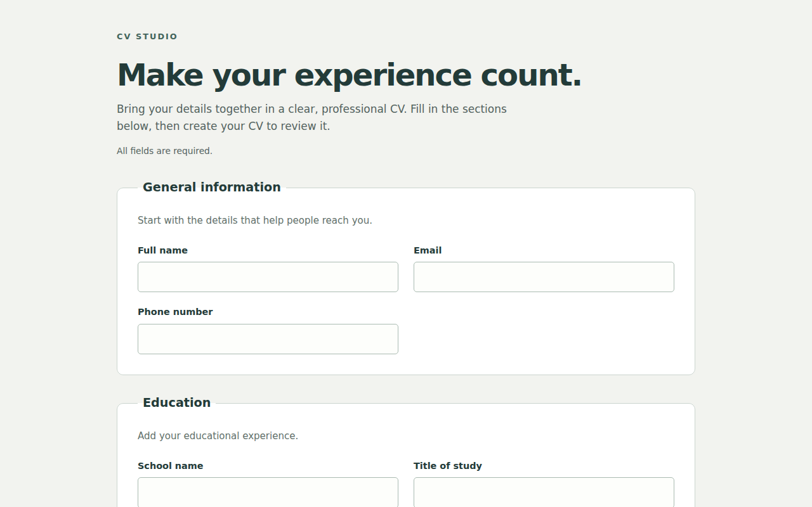
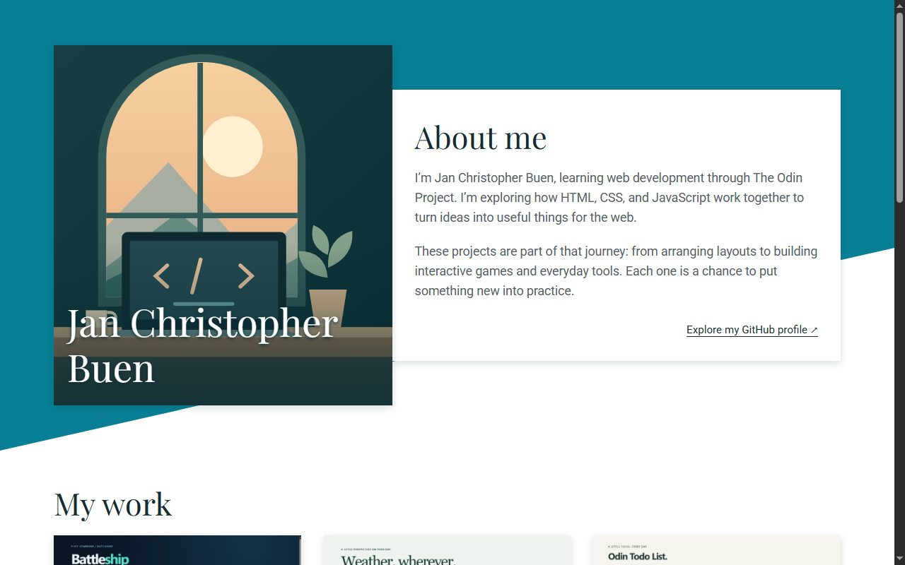

## Hi, I'm JC 👋

I'm an aspiring web developer from the Philippines, learning full stack JavaScript through [The Odin Project](https://www.theodinproject.com/). I build projects to practice each new topic, sharing the code and live demos where applicable.

- 🌱 Currently practicing: React routing, shared state, custom hooks, and user-focused testing through The Odin Project; recently built and deployed Common Goods, a shopping cart storefront
- 🎯 Goal: to work as a web developer on a team
- 🛠️ Tools I use every day: VS Code, Git, GitHub, and Linux (WSL)

### Skills

- **JavaScript:** classes, ES modules, DOM manipulation, event delegation, application state, localStorage, promises, async/await, Fetch API, JSON processing, and error handling.
- **React:** function components, JSX, props, controlled inputs, useState, lifting state, derived state, immutable updates, pure functional updaters, event handling, conditional rendering, stable list keys, useEffect dependencies and cleanup, custom fetch hooks, React Router nested routes, Outlet context, and shared state across navigation.
- **Testing practice:** React Testing Library and user-event with Vitest and jsdom for navigation, quantity controls, cart behavior, and API loading/error/retry states using deterministic network mocks; unit tests with Jest and Node.js's built-in test runner, strict assertions, testing public behavior, DOM-independent game models and turn controllers, independent shortest-path verification, and practicing the red/green/refactor cycle. Babel supports ES module conversion in Jest projects.
- **Data structures and algorithms:** linked lists, hash maps and sets, binary search trees, recursion, BFS and DFS traversal, shortest paths, and time and space complexity.
- **Frontend workflow:** npm, Vite, Webpack, ESLint, Prettier, API loading and retry states, AbortController cleanup, in-memory response caching, responsive CSS and CSS Modules, keyboard navigation, live status announcements, drag-and-drop with alternative controls, automated testing, GitHub Pages deployment with GitHub Actions, and Vercel deployment from GitHub.

### Learning Projects

#### Knights Travails

[Code](https://github.com/jan-christopher-buen/odin-knights-travails)

Finds one shortest legal knight path between any two squares on a standard 8-by-8 chessboard using breadth-first search. Runs in the terminal with Node.js, validates inputs without modifying them, and verifies all 4,096 start/destination pairs against independent Floyd–Warshall reference distances.

**Tools:** JavaScript, Node.js, npm, node:test · **Concepts practiced:** implicit graphs, BFS layers, visited tracking, predecessor reconstruction, deterministic tie-breaking, and shortest-path verification.

#### Binary Search Trees

[Code](https://github.com/jan-christopher-buen/odin-binary-search-trees)

An initially balanced binary search tree with lookup, insertion, successor-based deletion, four traversal orders, height and depth queries, and explicit rebalancing. Runs in the terminal with Node.js and includes 36 deterministic tests using the built-in test runner.

**Tools:** JavaScript, Node.js, npm · **Concepts practiced:** BST ordering, node references, breadth-first and depth-first traversal, subtree balance, rebalancing, and time and space complexity.

#### HashMap and HashSet

[Code](https://github.com/jan-christopher-buen/odin-hashmap)

Hash map and key-only hash set implementations with linked collision chains, capacity doubling, and entry rehashing. Runs in the terminal with Node.js and includes 31 automated tests using the built-in test runner.

**Tools:** JavaScript, Node.js, npm · **Concepts practiced:** hashing, buckets, separate chaining, load factor, rehashing, and expected, worst-case, and amortized complexity.

#### Linked Lists

[Code](https://github.com/jan-christopher-buen/odin-linked-lists)

A singly linked list built with JavaScript classes and ES modules, including search, indexed insertion and removal, and string formatting. Runs in the terminal with Node.js and includes 15 automated tests using the built-in test runner.

**Tools:** JavaScript, Node.js, npm · **Concepts practiced:** nodes and references, iterative traversal, link updates, index validation, and time and space complexity.

#### Recursion

[Code](https://github.com/jan-christopher-buen/odin-recursion)

Iterative and recursive Fibonacci sequences, plus recursive merge sort that preserves duplicates and leaves the input unchanged. Runs in the terminal with Node.js and includes automated checks using built-in assertions.

**Tools:** JavaScript, Node.js, npm · **Concepts practiced:** recursion, base cases, divide and conquer, input validation, and time and space complexity.

#### Testing Practice

[Code](https://github.com/jan-christopher-buen/odin-testing-practice)

JavaScript exercises built using a test-first workflow, with 39 passing tests across five suites. Covers string functions, calculator operations, a Caesar cipher, and array analysis.

**Tools:** Jest, Babel, npm · **Concepts practiced:** unit testing, ES modules, public behavior testing, and red/green/refactor.

### Projects

<table>
  <tr>
    <td width="50%" valign="top">
      
      <h4>🛍️ Common Goods</h4>
      
Explore a live catalog of everyday goods. Edit quantities and build a shared cart. Includes route and interaction tests. React · Router · CSS Modules · Vitest

      <a href="https://odin-shopping-cart-lilac.vercel.app/">Live demo</a> · <a href="https://github.com/jan-christopher-buen/odin-shopping-cart">Code</a>
    </td>
    <td width="50%" valign="top">
      
      <h4>🧠 Pokémon Memory</h4>
      
Remember Pokémon as the cards shuffle. Track your current and best scores. Includes replay and API retry states. React · JavaScript · Vite · PokéAPI

      <a href="https://odin-memory-card-eta-silk.vercel.app/">Live demo</a> · <a href="https://github.com/jan-christopher-buen/odin-memory-card">Code</a>
    </td>
  </tr>
  <tr>
    <td width="50%" valign="top">
      
      <h4>📄 CV Application</h4>
      
Build a CV from your personal details. Add education and work experience. Preview and edit your information. React · JavaScript · Vite · CSS

      <a href="https://odin-cv-application-bice.vercel.app/">Live demo</a> · <a href="https://github.com/jan-christopher-buen/odin-cv-application">Code</a>
    </td>
    <td width="50%" valign="top">
      
      <h4>🏠 Homepage</h4>
      
Explore a responsive portfolio homepage. Browse the illustrated introduction. View projects and the GitHub contact. HTML · CSS Grid · Flexbox

      <a href="https://jan-christopher-buen.github.io/odin-homepage/">Live demo</a> · <a href="https://github.com/jan-christopher-buen/odin-homepage">Code</a>
    </td>
  </tr>
  <tr>
    <td width="50%" valign="top">
      
      <h4>🚢 Battleship</h4>
      
Place your fleet and find enemy ships. Play against a computer opponent. Or share private local two-player turns. JavaScript · Jest · Webpack

      <a href="https://jan-christopher-buen.github.io/odin-battleship/">Live demo</a> · <a href="https://github.com/jan-christopher-buen/odin-battleship">Code</a>
    </td>
    <td width="50%" valign="top">
      
      <h4>🌦️ Weather App</h4>
      
Search locations for current weather. Explore the five-day weather forecast. Switch Celsius and Fahrenheit units. JavaScript · Fetch API · Webpack

      <a href="https://jan-christopher-buen.github.io/odin-weather-app/">Live demo</a> · <a href="https://github.com/jan-christopher-buen/odin-weather-app">Code</a>
    </td>
  </tr>
  <tr>
    <td width="50%" valign="top">
      
      <h4>✅ Todo List</h4>
      
Keep your tasks organized by project. Set due dates and choose priorities. Edit tasks and track their completion. JavaScript · Webpack · localStorage

      <a href="https://jan-christopher-buen.github.io/odin-todo-list/">Live demo</a> · <a href="https://github.com/jan-christopher-buen/odin-todo-list">Code</a>
    </td>
    <td width="50%" valign="top">
      
      <h4>🍽️ Restaurant Page</h4>
      
Explore a Filipino restaurant website. Browse the Home and Menu pages. Find restaurant details under Contact. JavaScript · ES modules · Webpack

      <a href="https://jan-christopher-buen.github.io/odin-restaurant-page/">Live demo</a> · <a href="https://github.com/jan-christopher-buen/odin-restaurant-page">Code</a>
    </td>
  </tr>
  <tr>
    <td width="50%" valign="top">
      
      <h4>❌⭕ Tic Tac Toe</h4>
      
Challenge a friend to Tic Tac Toe. Enter custom names for both players. Take turns on a shared game board. JavaScript · Factories · Modules

      <a href="https://jan-christopher-buen.github.io/odin-tic-tac-toe/">Live demo</a> · <a href="https://github.com/jan-christopher-buen/odin-tic-tac-toe">Code</a>
    </td>
    <td width="50%" valign="top">
      
      <h4>📚 Library</h4>
      
Keep a personal collection of books. Add new entries or remove old ones. Track which books you have read. JavaScript · Constructors · Dialog

      <a href="https://jan-christopher-buen.github.io/odin-library/">Live demo</a> · <a href="https://github.com/jan-christopher-buen/odin-library">Code</a>
    </td>
  </tr>
  <tr>
    <td width="50%" valign="top">
      
      <h4>📊 Admin Dashboard</h4>
      
Explore an admin dashboard layout. Browse its navigation and main panels. Built to practice grid-based page design. HTML · CSS Grid · Flexbox

      <a href="https://jan-christopher-buen.github.io/odin-admin-dashboard/">Live demo</a> · <a href="https://github.com/jan-christopher-buen/odin-admin-dashboard">Code</a>
    </td>
    <td width="50%" valign="top">
      
      <h4>📝 Sign-up Form</h4>
      
Explore a styled account sign-up page. Enter information in labeled fields. Practice form layout and validation. HTML · Forms · CSS

      <a href="https://jan-christopher-buen.github.io/odin-sign-up-form/">Live demo</a> · <a href="https://github.com/jan-christopher-buen/odin-sign-up-form">Code</a>
    </td>
  </tr>
  <tr>
    <td width="50%" valign="top">
      
      <h4>🧮 Calculator</h4>
      
Use an on-screen browser calculator. Enter numbers and choose operations. Built with JavaScript and Flexbox. JavaScript · HTML · Flexbox

      <a href="https://jan-christopher-buen.github.io/odin-calculator/">Live demo</a> · <a href="https://github.com/jan-christopher-buen/odin-calculator">Code</a>
    </td>
    <td width="50%" valign="top">
      
      <h4>🎨 Etch-a-Sketch</h4>
      
Draw in a browser-based sketchpad. Resize the grid to change your canvas. Practice JavaScript DOM interaction. JavaScript · HTML · DOM

      <a href="https://jan-christopher-buen.github.io/odin-etch-a-sketch/">Live demo</a> · <a href="https://github.com/jan-christopher-buen/odin-etch-a-sketch">Code</a>
    </td>
  </tr>
  <tr>
    <td width="50%" valign="top">
      
      <h4>✊ Rock Paper Scissors</h4>
      
Play Rock Paper Scissors in a browser. Choose a move against the computer. Be the first player to reach five wins. JavaScript · HTML · DOM

      <a href="https://jan-christopher-buen.github.io/odin-rock-paper-scissors/">Live demo</a> · <a href="https://github.com/jan-christopher-buen/odin-rock-paper-scissors">Code</a>
    </td>
    <td width="50%" valign="top">
      
      <h4>🌐 Landing Page</h4>
      
Explore a landing page from a design. Browse the content and page sections. Built to practice HTML and Flexbox. HTML · CSS · Flexbox

      <a href="https://jan-christopher-buen.github.io/odin-landing-page/">Live demo</a> · <a href="https://github.com/jan-christopher-buen/odin-landing-page">Code</a>
    </td>
  </tr>
  <tr>
    <td width="50%" valign="top">
      
      <h4>🍲 Recipes</h4>
      
Browse a small collection of recipes. Open a recipe to read its instructions. My first project in The Odin Project. HTML · Links · Lists

      <a href="https://jan-christopher-buen.github.io/odin-recipes/">Live demo</a> · <a href="https://github.com/jan-christopher-buen/odin-recipes">Code</a>
    </td>
  </tr>
</table>
