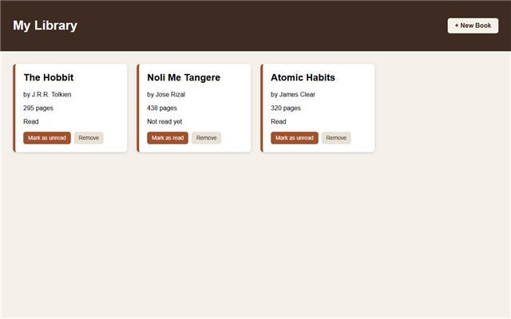
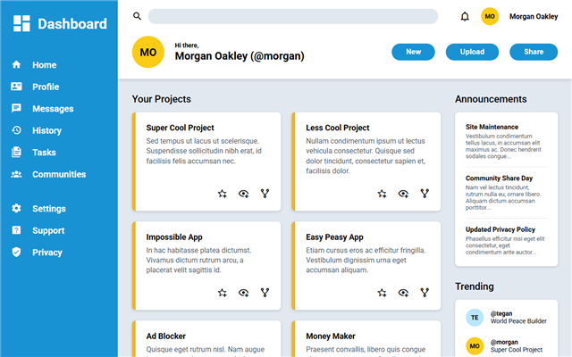
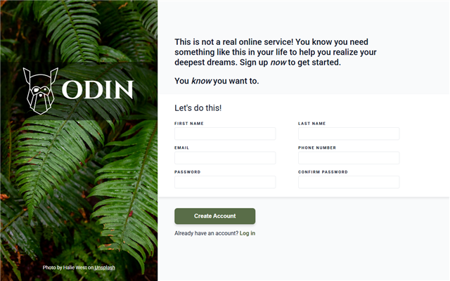
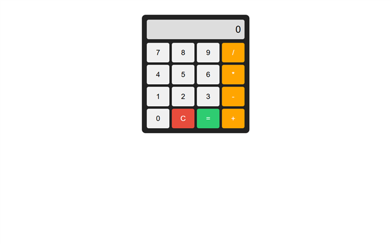
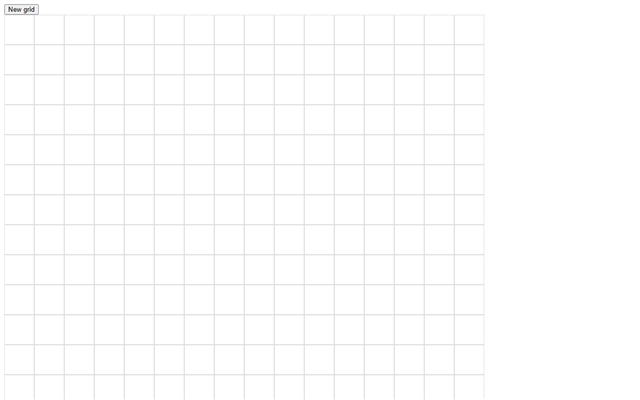
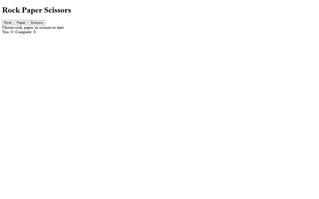
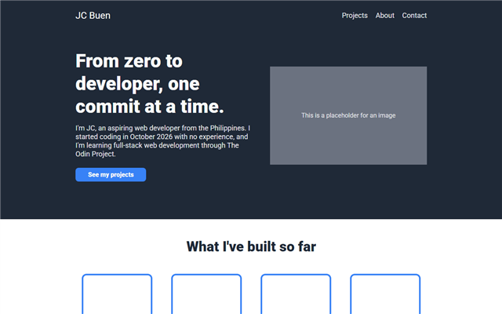
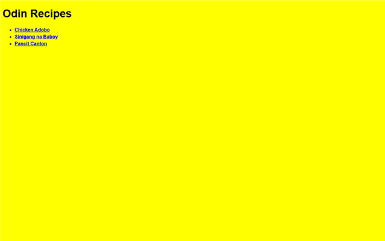

## Hi, I'm JC 👋

I'm an aspiring web developer from the Philippines, learning full stack JavaScript through [The Odin Project](https://www.theodinproject.com/). I build a project for every new topic and publish each one live.

- 🌱 Currently learning: JavaScript (objects, constructors, and organizing code)
- 🎯 Goal: to work as a web developer on a team
- 🛠️ Tools I use every day: VS Code, Git, GitHub, and Linux (WSL)

### Skills

### Projects

<table>
  <tr>
    <td width="50%" valign="top">
      
      <h4>📚 Library</h4>
      
Add, remove, and track books you've read. JavaScript · constructors · &lt;dialog&gt;

      <a href="https://jan-christopher-buen.github.io/odin-library/">Live demo</a> · <a href="https://github.com/jan-christopher-buen/odin-library">Code</a>
    </td>
    <td width="50%" valign="top">
      
      <h4>📊 Admin Dashboard</h4>
      
A dashboard page layout. CSS Grid · Flexbox

      <a href="https://jan-christopher-buen.github.io/odin-admin-dashboard/">Live demo</a> · <a href="https://github.com/jan-christopher-buen/odin-admin-dashboard">Code</a>
    </td>
  </tr>
  <tr>
    <td width="50%" valign="top">
      
      <h4>📝 Sign-up Form</h4>
      
A sign-up page with form validation. HTML forms · CSS

      <a href="https://jan-christopher-buen.github.io/odin-sign-up-form/">Live demo</a> · <a href="https://github.com/jan-christopher-buen/odin-sign-up-form">Code</a>
    </td>
    <td width="50%" valign="top">
      
      <h4>🧮 Calculator</h4>
      
An on-screen calculator. JavaScript · Flexbox

      <a href="https://jan-christopher-buen.github.io/odin-calculator/">Live demo</a> · <a href="https://github.com/jan-christopher-buen/odin-calculator">Code</a>
    </td>
  </tr>
  <tr>
    <td width="50%" valign="top">
      
      <h4>🎨 Etch-a-Sketch</h4>
      
A browser sketchpad with a resizable grid. JavaScript · DOM

      <a href="https://jan-christopher-buen.github.io/odin-etch-a-sketch/">Live demo</a> · <a href="https://github.com/jan-christopher-buen/odin-etch-a-sketch">Code</a>
    </td>
    <td width="50%" valign="top">
      
      <h4>✊ Rock Paper Scissors</h4>
      
A game against the computer, first to 5 wins. JavaScript · DOM

      <a href="https://jan-christopher-buen.github.io/odin-rock-paper-scissors/">Live demo</a> · <a href="https://github.com/jan-christopher-buen/odin-rock-paper-scissors">Code</a>
    </td>
  </tr>
  <tr>
    <td width="50%" valign="top">
      
      <h4>🌐 Landing Page</h4>
      
A landing page from a design. HTML · Flexbox

      <a href="https://jan-christopher-buen.github.io/odin-landing-page/">Live demo</a> · <a href="https://github.com/jan-christopher-buen/odin-landing-page">Code</a>
    </td>
    <td width="50%" valign="top">
      
      <h4>🍲 Recipes</h4>
      
A small recipe website (my first project). HTML

      <a href="https://jan-christopher-buen.github.io/odin-recipes/">Live demo</a> · <a href="https://github.com/jan-christopher-buen/odin-recipes">Code</a>
    </td>
  </tr>
</table>
