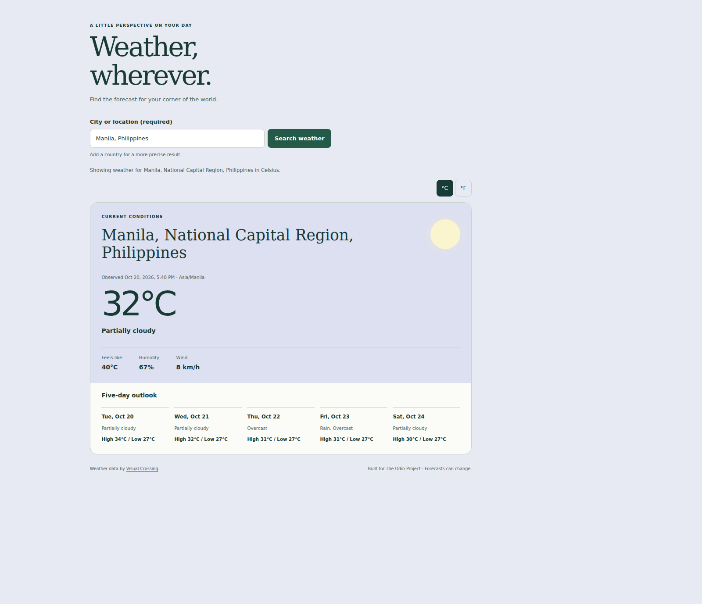
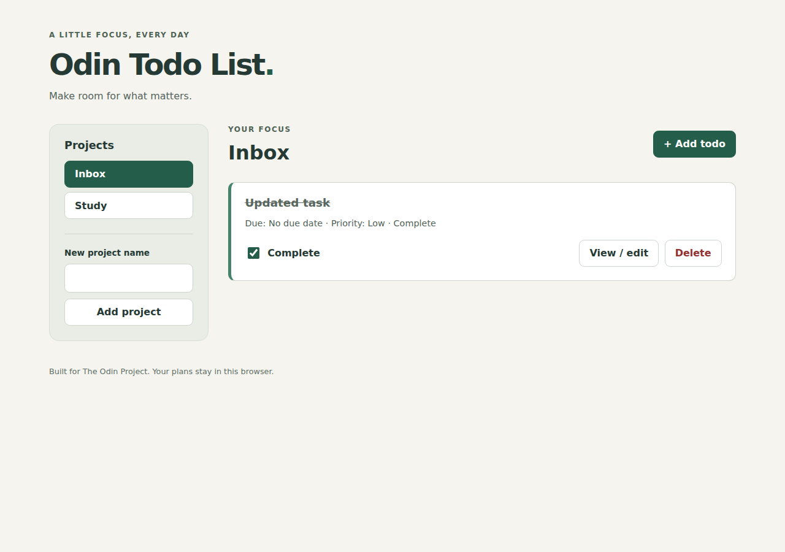
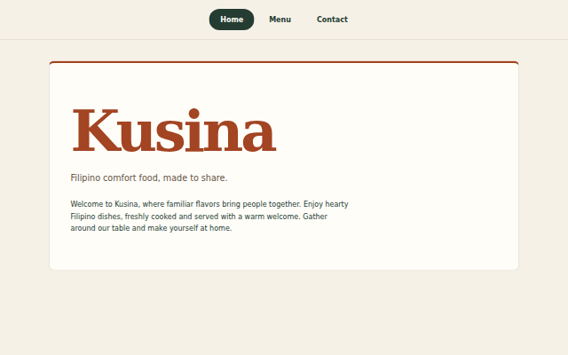
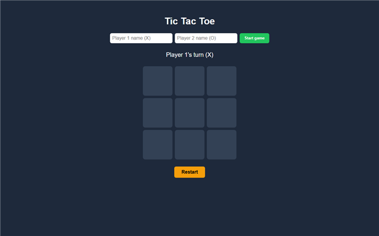

## Hi, I'm JC 👋

I'm an aspiring web developer from the Philippines, learning full stack JavaScript through [The Odin Project](https://www.theodinproject.com/). I build projects to practice each new topic, sharing the code and live demos where applicable.

- 🌱 Currently learning: unit testing with Jest and test-driven development (TDD) through The Odin Project
- 🎯 Goal: to work as a web developer on a team
- 🛠️ Tools I use every day: VS Code, Git, GitHub, and Linux (WSL)

### Skills

- **JavaScript:** ES modules, DOM manipulation, localStorage, promises, async/await, Fetch API, JSON processing, and error handling.
- **Testing practice:** unit tests with Jest, Babel for ES module conversion, testing public behavior, and practicing the red/green/refactor cycle.
- **Frontend workflow:** npm, Webpack, responsive CSS, basic accessibility, automated testing, and GitHub Pages deployment with GitHub Actions.

### Learning Projects

#### Testing Practice

[Code](https://github.com/jan-christopher-buen/odin-testing-practice)

JavaScript exercises built using a test-first workflow, with 39 passing tests across five suites. Covers string functions, calculator operations, a Caesar cipher, and array analysis.

**Tools:** Jest, Babel, npm · **Concepts practiced:** unit testing, ES modules, public behavior testing, and red/green/refactor.

### Projects

<table>
  <tr>
    <td width="50%" valign="top">
      
      <h4>🌦️ Weather App</h4>
      
Search locations for current weather and a five-day forecast, with loading/error states and a Celsius/Fahrenheit toggle. JavaScript · async/await · Fetch API · Visual Crossing · Webpack

      <a href="https://jan-christopher-buen.github.io/odin-weather-app/">Live demo</a> · <a href="https://github.com/jan-christopher-buen/odin-weather-app">Code</a>
    </td>
    <td width="50%" valign="top">
      
      <h4>✅ Todo List</h4>
      
Organize todos into projects with due dates, priorities, editing, and completion tracking. JavaScript · factory functions · Webpack · localStorage

      <a href="https://jan-christopher-buen.github.io/odin-todo-list/">Live demo</a> · <a href="https://github.com/jan-christopher-buen/odin-todo-list">Code</a>
    </td>
  </tr>
  <tr>
    <td width="50%" valign="top">
      
      <h4>🍽️ Restaurant Page</h4>
      
A Filipino restaurant website with Home, Menu, and Contact pages. JavaScript · ES modules · Webpack · DOM

      <a href="https://jan-christopher-buen.github.io/odin-restaurant-page/">Live demo</a> · <a href="https://github.com/jan-christopher-buen/odin-restaurant-page">Code</a>
    </td>
    <td width="50%" valign="top">
      
      <h4>❌⭕ Tic Tac Toe</h4>
      
A two-player game with custom player names. JavaScript · factory functions · module pattern

      <a href="https://jan-christopher-buen.github.io/odin-tic-tac-toe/">Live demo</a> · <a href="https://github.com/jan-christopher-buen/odin-tic-tac-toe">Code</a>
    </td>
  </tr>
  <tr>
    <td width="50%" valign="top">
      
      <h4>📚 Library</h4>
      
Add, remove, and track books you've read. JavaScript · constructors · &lt;dialog&gt;

      <a href="https://jan-christopher-buen.github.io/odin-library/">Live demo</a> · <a href="https://github.com/jan-christopher-buen/odin-library">Code</a>
    </td>
    <td width="50%" valign="top">
      
      <h4>📊 Admin Dashboard</h4>
      
A dashboard page layout. CSS Grid · Flexbox

      <a href="https://jan-christopher-buen.github.io/odin-admin-dashboard/">Live demo</a> · <a href="https://github.com/jan-christopher-buen/odin-admin-dashboard">Code</a>
    </td>
  </tr>
  <tr>
    <td width="50%" valign="top">
      
      <h4>📝 Sign-up Form</h4>
      
A sign-up page with form validation. HTML forms · CSS

      <a href="https://jan-christopher-buen.github.io/odin-sign-up-form/">Live demo</a> · <a href="https://github.com/jan-christopher-buen/odin-sign-up-form">Code</a>
    </td>
    <td width="50%" valign="top">
      
      <h4>🧮 Calculator</h4>
      
An on-screen calculator. JavaScript · Flexbox

      <a href="https://jan-christopher-buen.github.io/odin-calculator/">Live demo</a> · <a href="https://github.com/jan-christopher-buen/odin-calculator">Code</a>
    </td>
  </tr>
  <tr>
    <td width="50%" valign="top">
      
      <h4>🎨 Etch-a-Sketch</h4>
      
A browser sketchpad with a resizable grid. JavaScript · DOM

      <a href="https://jan-christopher-buen.github.io/odin-etch-a-sketch/">Live demo</a> · <a href="https://github.com/jan-christopher-buen/odin-etch-a-sketch">Code</a>
    </td>
    <td width="50%" valign="top">
      
      <h4>✊ Rock Paper Scissors</h4>
      
A game against the computer, first to 5 wins. JavaScript · DOM

      <a href="https://jan-christopher-buen.github.io/odin-rock-paper-scissors/">Live demo</a> · <a href="https://github.com/jan-christopher-buen/odin-rock-paper-scissors">Code</a>
    </td>
  </tr>
  <tr>
    <td width="50%" valign="top">
      
      <h4>🌐 Landing Page</h4>
      
A landing page from a design. HTML · Flexbox

      <a href="https://jan-christopher-buen.github.io/odin-landing-page/">Live demo</a> · <a href="https://github.com/jan-christopher-buen/odin-landing-page">Code</a>
    </td>
    <td width="50%" valign="top">
      
      <h4>🍲 Recipes</h4>
      
A small recipe website (my first project). HTML

      <a href="https://jan-christopher-buen.github.io/odin-recipes/">Live demo</a> · <a href="https://github.com/jan-christopher-buen/odin-recipes">Code</a>
    </td>
  </tr>
</table>
